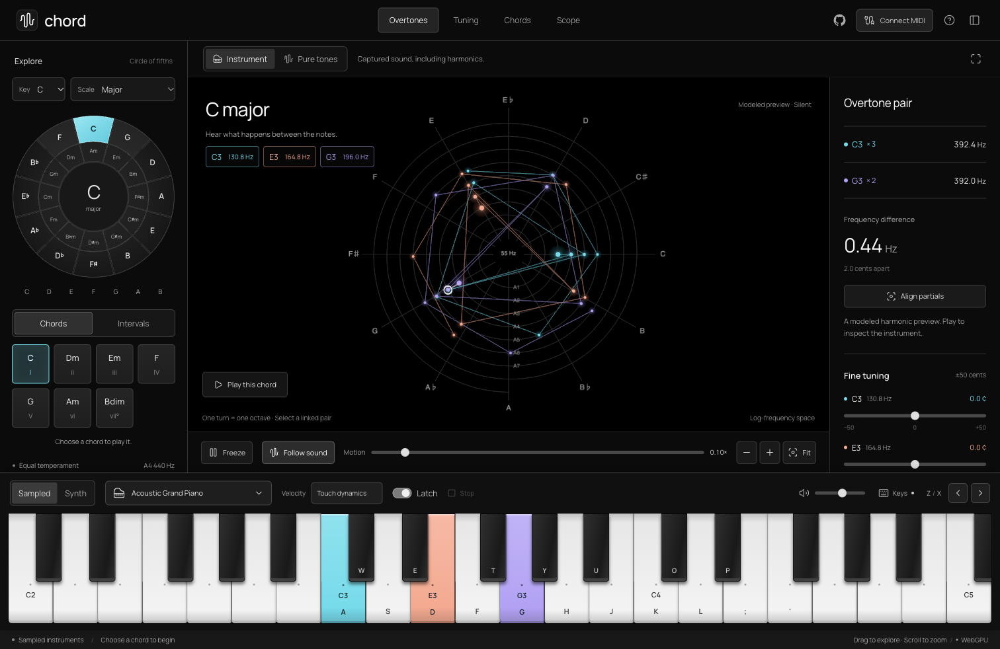

# chord

A playable instrument for exploring harmony through sound and geometry. Four connected workspaces share one keyboard, instrument, selected notes, and tuning. Built with Svelte 5, SvelteKit 3, TypeScript, Web Audio, and Three.js WebGPU.

[Play Chord](https://neovand.github.io/chord/) · [Architecture and design decisions](docs/architecture.md)



## Four views, one instrument

- **Overtones** places measured spectral peaks on a log-frequency spiral: one turn per octave. Select a nearby pair to inspect its frequency difference, slow its beat animation, and align the peaks by retuning a voice.
- **Tuning** plots an estimated sensory-roughness surface. Drag the surface to tune notes two and three; drag outside it to orbit. Sliders provide the same controls. Equal and Just are explicit tuning references. The landscape depends on the captured timbre and is not a score for musical quality.
- **Chords** is a playable Tonnetz of fifths and thirds. Major/minor triangles, parallel/relative/leading-tone transformations, common notes, and voice-leading paths connect neighboring chords. Edit and play a four-step progression, then inspect it in any workspace. Manual playing or Stop cancels it.
- **Scope** preserves the high-resolution waveform, two-note XY, and three-note XYZ views, including their independent cameras, complete paths, glowing sweep, deep zoom, and miniature signal traces.

The active keyboard and sound controls stay available in every workspace. Switching views preserves notes, tuning, camera state, and visual pause. Touch layouts stack inspectors without removing tools; reduced-motion preferences start the visual clock paused.

## Run

```sh
pnpm install
pnpm dev
pnpm check
pnpm exec vitest run
pnpm build
pnpm exec playwright test
```

The page starts with a labelled, silent modeled harmonic preview. Scope uses a sine preview. Playing a key or chord starts audio through a user gesture. Sampled instruments download their recordings on first use; the local synth plays while loading and remains available if a download fails.

## Playing and inspecting

- **Instrument / Pure tones** changes both the sound and the captured signal. Instrument retains the selected sampled or synthesized voice, including its harmonics. Pure tones substitutes sine oscillators at the same pitches. Pure tones does not change equal temperament into just intonation.
- **Sampled / Synth** chooses the instrument engine. The 128 General MIDI sample programs use smplr; synthesized voices use MIDI Lab's 16 family presets with dual oscillators, detuning, velocity-sensitive filter envelopes, and amplitude envelopes. Programs in the same synth family share a timbre.
- **Latch** keeps notes selected after release; recorded instruments still decay naturally. Adding or removing a latched note with the computer or on-screen keyboard replays the selected notes together, so an older, decayed piano voice cannot flatten an axis when building a chord. Momentary playing and MIDI keep their normal note envelopes. Selecting a chord replaces the previous chord. Stop sound clears the held keys while keeping the last completed capture available for inspection; the status explicitly says sound has stopped. Changing sound source while stopped clears that retained capture. A connected MIDI sustain pedal can still send its normal CC64 messages.
- **Follow sound** starts enabled. The sweep and automatic orbit move only while the actual master output is audible; the highlight and miniature scopes fade with its measured envelope. Natural sample endings and mute stop motion even when notes remain latched. Turn it off for **Free run**, which animates the captured shape in silence. The complete path stays available in both modes.
- **Sweep speed** controls a glowing highlight traveling over a fixed, complete path, from 2 to 200 seconds per sweep (20 seconds by default). Waveforms stay stationary. **Tail length** changes only the highlight, never the underlying curve.
- **Freeze** pauses the highlight, miniature scopes, and automatic orbit independently of sound. It stays paused across view, chord, and source changes until Resume is pressed; a newly selected sound is captured in that paused state. The camera can still be moved. **Recapture** explicitly replaces an instrument's held waveform with a new complete audio window.
- In **Scope**, scroll or pinch to zoom up to **128×**; zoom follows the pointer. **Fit** (or double-clicking the canvas) centers the actual curve while preserving the viewing direction. **Reset rotation** restores the 3D starting direction while preserving magnification. Drag to orbit in 3D, Shift-drag/right-drag to pan. Drag pans in 2D and waveform views. Each view retains its own camera, and changing notes never resets zoom. Automatic orbit starts off.
- **Waveform / 2D / 3D** selects a time plot, a two-note XY plot, or a three-note XYZ plot. This choice always persists through chord, interval, and keyboard input. Insufficient notes produce a prompt instead of silently changing views. Larger keyboard combinations can sound; the parametric plot explicitly identifies its first two or three plotted voices.
- The circle of fifths, scale selector, chord pads, interval presets, piano, and connected MIDI inputs all feed the same note state.

Computer keys follow MIDI Lab: `A W S E D F T G Y H U J K O L P ; '` play chromatically; `Z` / `X` shift the octave. Musical shortcuts are suppressed while typing, navigating the circle, or using dialogs and focused controls. `Cmd/Ctrl + .` stops sound. Circle navigation keeps its curved keyboard focus indicator; mouse input does not show a rectangular focus box.

## Tuning and spectral analysis

Fine tuning spans ±50 cents per selected MIDI pitch. Synth oscillators and sampled buffer sources glide through native audio parameters without restarting their envelopes. A tuning edit versions all chord members on one capture clock, preventing stale axes. A new chord resets its offsets; Replay selection retains them and rearticulates finite recordings.

A worker applies a 16,384-sample Hann-windowed FFT to each isolated voice, then interpolates local peaks and retains up to sixteen significant partials. These are measured peaks, including inharmonic components, rather than a reconstruction of the instrument as ideal harmonics. The harmonic number shown beside a peak is approximate. The finite analysis window limits frequency resolution and excludes much of the initial attack. Captures remain inspectable after decay; Recapture explicitly takes another window. Tuning temporarily projects the last measured frequencies until a fresh settled capture arrives, and the interface labels that projection.

The overtone pair animation represents the measured frequency difference multiplied by the visual speed. Follow sound gates it with the audible output. The tuning surface uses the [Sethares critical-band roughness kernel](https://sethares.engr.wisc.edu/comprog.html), minimum-amplitude weighting, and cross-note partial pairs. A worker samples a 65×65 grid over ±50 cents for notes two and three, holding every other selected note fixed. Height is normalized within that surface, so comparing heights across different instruments is not an absolute loudness or consonance comparison. Pure tones need not have the familiar valleys of harmonic instruments. The model excludes rhythm, musical context, expectation, and cultural preference.

## Deployment

Every push to `main` runs type checking, lint, mathematical/audio tests, and Playwright production-browser regressions in [GitHub Actions](https://github.com/NeoVand/chord/actions). Passing builds deploy the static site to GitHub Pages. Pull requests run the same checks without deploying.

The Pages build sets `BASE_PATH=/chord`; SvelteKit resolves JavaScript, workers, fonts, and the audio worklet under that repository path. To verify locally:

```sh
BASE_PATH=/chord pnpm build
BASE_PATH=/chord pnpm preview
```

Open `/chord/` on the preview server. Development uses `/` as usual. The checked-in pnpm version and lockfile keep installs reproducible.

## Signal path

Each voice routes through its own mono bus to both the master audio output and an eight-channel merger. An AudioWorklet captures all channels on one sample clock, with frame-exact voice IDs and versions. Changing an instrument or replacing a temporary synth with a loaded sample starts a new capture version, so the plot never silently replays the old timbre under the new label.

The plot reads the actual PCM with linear interpolation, including the pure sine engine. After a 45 ms onset allowance, it waits for a complete aligned window, copies it, and commits its geometry and one common display gain together. This preserves relative axis amplitudes without a growing trace or automatic gain/zoom animation. The capture stays immutable as the two-second input ring buffer wraps. Selecting new notes or an instrument takes a new capture; Recapture samples a later moment, useful for evolving timbres and envelopes. Mini waveforms use the same immutable snapshot. Queued old-engine blocks are rejected on switching. The silent opening preview is the only analytically generated curve.

Parametric paths contain 131,072 source points over 24 fundamental cycles, bounded to 20–750 ms; waveform lanes show four cycles with 32,768 source points. These are complete **finite trajectories**: equal-tempered intervals generally do not close exactly, so the renderer never invents an endpoint connection. Interpolating captured PCM increases drawing resolution without claiming additional audio bandwidth.

The spectrum comes from the real master output through audioMotion. The parametric axes come from individual voices, rather than attempting to recover notes from a mixed spectrum. Stereo sampled voices are summed to mono for their individual axes. Master volume and limiting are applied after the per-note capture. Follow sound uses a short RMS window after volume and limiting, with attack/release smoothing and silence hysteresis. It follows the audible envelope while retaining the immutable curve; it does not continuously replace the path with evolving audio. Latched chord edits share one scheduled attack time, including already-loaded samples, and invalidate the prior voice generations.

Three.js uses WebGPU and falls back to WebGL2 where WebGPU is unavailable. The application reports the active backend. Bounded-error polyline simplification adapts GPU tessellation to the zoom level while retaining the full-resolution path. Geometry uploads occur only on capture/view/zoom-detail changes, not every animation frame. TSL fragment shaders animate the highlight with sweep, tail, and activity uniforms; cumulative arc length gives it an even speed around parametric curves. Restrained screen-space halos and normal alpha blending prevent additive whiteout at intersections. Orthographic cameras make deep zoom magnify the shape without flying through it. The miniature scopes scroll a two-cycle window around a synchronized probe at 30 fps. Inverting arc length back to source time keeps them aligned with the main highlight; peak measurements stay cached by capture identity.

## Source and extension points

MIDI Lab supplied the keyboard interaction and geometry, voice selector, circle-of-fifths geometry and musical data, audioMotion configuration, GM program map, sample-loading strategy, and subtractive synth presets/voice design. Components are adapted to Chord's shared state instead of importing MIDI Lab's course or transport system.

Audio lives in `src/lib/audio/`, musical data in `src/lib/music/`, spectral/tuning/lattice models in `src/lib/harmony/`, and captured-signal rendering in `src/lib/visualization/`. `src/lib/types.ts` and `src/lib/harmony/types.ts` define their boundaries. The OP-XY replica's per-voice SourceGraph engines are a future adapter at the audio voice output boundary; its engines, LFO controls, and effects panel are not included in this version.

The original UI concept is saved in `design/concepts/`; the three approved future directions are in `design/futures-2026-10-30/`.

The interface uses a true-black canvas and neutral grayscale surfaces. Cyan, coral, and violet connect the animated curve highlight, individual waveforms, note labels, and selected piano keys; cyan identifies the selected chord. The complete parametric path stays neutral so its colored moving highlight stands out. Lucide icons through `@lucide/svelte` include the Audio Waveform brand mark and favicon; the source link uses GitHub's Octicons mark.
