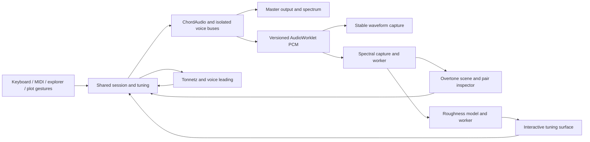

# Chord architecture and delivery plan

Chord is one playable instrument with four ways to inspect the same musical selection. Overtones reveals spectral relationships, Tuning explores estimated sensory roughness, Chords reveals common tones and voice leading, and Scope retains the waveform and Lissajous views. The keyboard, audio engine, note identities, tuning, and source choice persist across all four.

## Interaction and visual hierarchy

The top bar contains the four workspaces, source mode, help, MIDI, and the GitHub source link. A compact explorer provides the circle of fifths, scales, chords and intervals. The center is the visual instrument; its adjacent inspector describes and edits the selected musical relationship. A single sound toolbar and keyboard stay available below it. Smaller screens stack the inspector and let the explorer collapse without hiding the sound controls.

Use true black for plots, neutral charcoal for controls, readable Manrope typography, and cyan/coral/violet for musical identity. Keep color consistent across notes, plots, inspectors and piano keys. Glow indicates audible activity or an explicit inspection animation. Selected controls use restrained contrast. Geometry, rather than a dashboard of statistics, owns most of the screen.

Latch controls held notes. Freeze controls visual motion. Follow sound gates motion with measured output; Free run permits silent inspection. Tuning controls change pitch; slow motion changes only visual time. Choosing a chord never changes workspace or Scope projection. Switching views never interrupts a held note.

## State and ownership

The page owns a per-instance session: held/physical/pedal note identities, retained and frozen selections, source, program, velocity, volume, tuning offsets, workspace and audition commands. Derived PlotNote.frequency is authoritative. Child components receive immutable snapshots and callbacks; they never create independent audio engines. No module-global reactive session is used.

Plain TypeScript modules implement tuning, spectral peak extraction, pair interactions, roughness, and Tonnetz/voice-leading calculations. These can be tested independently of graphics or Svelte. Heavy analysis and terrain sampling run in workers. The UI receives bounded snapshots, not a stream of reactive PCM arrays.

## Audio and analysis contracts

Every voice retains a stable ID and its own PCM bus. Instrument changes, retriggers and retuning produce explicit capture versions. Synth oscillators and recorded buffer playback support smooth pitch changes through AudioParams; tuning must not simulate pitch by changing only the picture. Loaded General MIDI buffers remain cached and shared. Released or superseded async loads cannot resurrect notes.

Spectra are extracted from per-voice PCM using a windowed FFT and interpolated peaks. At most sixteen useful partials per note are retained. Captured spectra remain inspectable after decay. While a new capture is pending, a frequency-shifted projection of the prior capture can be shown explicitly as a tuning projection. Before the first note, a clearly marked modeled preview introduces the interface without autoplay.

Overtone positions use log frequency: one turn per octave. A partial has an owning note, frequency, amplitude and approximate harmonic index. Pair selection reports frequency separation and provides an alignment action. Near-partial interactions are weighted by amplitude; no arbitrary links or invented consonance percentage are displayed.

The terrain is an estimated pairwise roughness surface using a Sethares-style critical-band model. X and Z vary the second and third selected notes around equal temperament; height is relative modeled roughness. It includes every selected voice while moving only the chosen pair. It is not a measure of musical quality or functional tension. Changing timbre changes the surface. A worker computes a bounded grid; stale jobs cannot replace newer requests.

The atlas uses a true fifth/third lattice and pitch-class triangles. Its transformation controls audition actual shared-session notes. Voice-leading distances are displayed in semitones with octave placement explicit; progression playback uses the same audio engine and is cancellable by Stop or manual playing.

## Rendering and performance

Use Three.js WebGPU with WebGL fallback for the harmonic and terrain scenes. Keep material and geometry allocations out of the animation loop. Reuse objects, bound pixel ratio, resize through ResizeObserver, and dispose listeners, workers, buffers and renderers. Suspend hidden rendering. Retain Scope's controller/camera and capture state while it is hidden; only its lightweight capture logic continues.

Use semantic SVG for the small interactive Tonnetz and circle so labels, focus targets and keyboard input remain accessible. DOM text supplies inspectors and axes. Reduced motion disables decorative movement; all musical actions remain available through buttons/sliders as well as canvas gestures.

## Delivery stages

1. Commit the design references and architecture.
2. Configure reproducible pnpm builds, checks and GitHub Pages deployment.
3. Add tested tuning and spectral model contracts.
4. Support continuous pitch updates in synth and sampled voices.
5. Add bounded spectral capture and pair analysis.
6. Add the shared workspace navigation, persistent controls and source link.
7. Build the WebGPU overtone scene, selection and alignment inspector.
8. Build and test the roughness worker and terrain data model.
9. Connect the terrain's draggable tuning, comparison and camera controls.
10. Build the playable Tonnetz, transformations and progression controls.
11. Verify cross-view state, audio cancellation, keyboard, freeze, mobile and accessibility behavior.
12. Polish visuals, document the models, verify the deployed application and push the release.

Each coherent stage is committed and pushed after its relevant checks. Prefer meaningful commits over an arbitrary count. GitHub Actions checks types, lint, unit/audio behavior and production output before deploying main to Pages. Browser regressions exercise the integration. The final site must load JavaScript, fonts and the AudioWorklet correctly under `/chord/`.

## References

- [Selected interface concepts](../design/futures-2026-10-30/selection.json)
- [Sethares on tuning and timbre](https://sethares.engr.wisc.edu/consemi.html)
- [Harmonics 3D and its frequency spiral](https://mir.sechsachtel.de/3d/)
- [Tymoczko on musical chord geometry](https://collaborate.princeton.edu/en/publications/the-geometry-of-musical-chords/)
